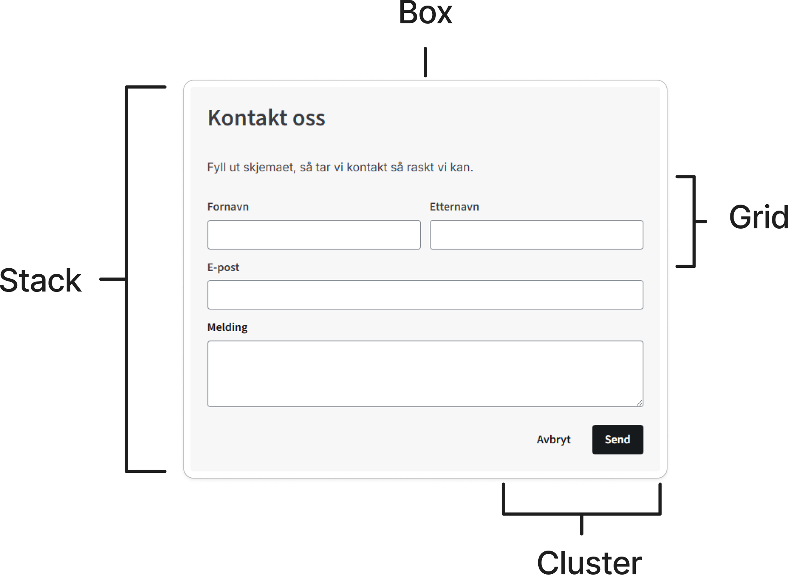

<PageHeader title="Layout-komponenter" imagePath="developer" pageLevel=1></PageHeader>

Layout-komponentene er strukturelle byggeklosser basert på prinsippene fra [Every Layout](https://every-layout.dev/).
De håndterer plassering og fordeling av innhold uten å binde seg til visuell stil og kan kombineres fritt for å bygge opp sider og seksjoner.

## Hvorfor bruke dem?

Du slipper å skrive egen CSS for vanlige oppsett, og avstander hentes fra designsystemets tokens. Det gir konsistente sider, raskere utvikling og mindre vedlikehold når designet endres.

## Når skal du bruke layout-komponenter?

Bruk layout-komponentene når du vil:

- Stable elementer vertikalt med konsistent mellomrom (`nve-stack`)
- Gruppere elementer horisontalt med automatisk linjebryting (`nve-cluster`)
- Lage et responsivt rutenett (`nve-grid`)
- Gi et element definert padding og bakgrunn (`nve-box`)

## Prinsipper

Layout-komponentene har ingen farger, fonter eller annen visuell stil, de styrer kun struktur og plassering. De er ment for å kombineres, og bryr seg ikke om hva som ligger inni dem.

Alle layout-komponentene støtter `as` for å velge hvilket native HTML-element som omslutter innholdet:

```html
<nve-stack as="section" aria-label="Kontaktinformasjon"> ... </nve-stack>
```

`as` velger HTML-elementet rundt innholdet inne i komponentens shadow DOM. Selve `<nve-stack>` ligger fortsatt i sidens DOM. Uten en eksplisitt `role` kommer semantikken fra HTML-elementet du valgte med `as`. Vil du gi komponenten en rolle eller et tilgjengelig navn/en beskrivelse, setter du `role` og relevante `aria-*`-attributter på `<nve-stack>`. Da er komponenten det semantiske elementet, og det indre elementet blir presentasjonelt. ARIA-referanser som `aria-labelledby` blir på komponenten og kan derfor peke på elementer i sidens DOM.

Gyldige verdier for `as` er `div`, `section`, `article`, `aside`, `nav`, `main`, `header`, `footer` og `ul`.

### Skjemaer

Ikke bruk `as="form"`. Layout-komponenten rendrer det valgte elementet inne i en shadow DOM, mens skjemakontrollene som legges inn via slot, fortsatt er i sidens DOM. Nettleseren knytter derfor ikke kontrollene til skjemaet inne i komponenten, og vanlig skjemavalidering og innsending vil ikke fungere som forventet.

Plasser i stedet layout-komponenten inni et vanlig `<form>`-element:

```html
<form>
  <nve-stack>
    <nve-input label="E-post" type="email"></nve-input>
    <nve-button type="submit">Send</nve-button>
  </nve-stack>
</form>
```

## Eksempel på bruk

Layout-komponentene er laget for å kombineres. Et kontaktskjema er et typisk eksempel som bruker alle fire: `nve-box` gir kortet ramme og padding, `nve-stack` stabler feltene vertikalt, `nve-grid` legger fornavn og etternavn ved siden av hverandre og bryter til en kolonne på smale skjermer. `nve-cluster` plasserer knappene nederst.

<CodeExamplePreview>

```html
<nve-box padding="large" background="--color-neutrals-background-canvas">
  <nve-stack>
    <nve-heading level="3">Kontakt oss</nve-heading>
    <p>Fyll ut skjemaet, så tar vi kontakt så raskt vi kan.</p>
    <nve-grid gap="small" min="220px">
      <nve-input label="Fornavn"></nve-input>
      <nve-input label="Etternavn"></nve-input>
    </nve-grid>
    <nve-input label="E-post" type="email"></nve-input>
    <nve-textarea label="Melding"></nve-textarea>
    <nve-cluster gap="small" justify="flex-end">
      <nve-button variant="ghost">Avbryt</nve-button>
      <nve-button variant="primary">Send</nve-button>
    </nve-cluster>
  </nve-stack>
</nve-box>
```

</CodeExamplePreview>



## Felles spacing-props

Alle layout-komponenter arver `padding`, `margin`, `padding-block`, `padding-inline`, `margin-block` og `margin-inline` fra en basis layoutklasse. Verdiene er låst til spacing-tokenene i designsystemet.
